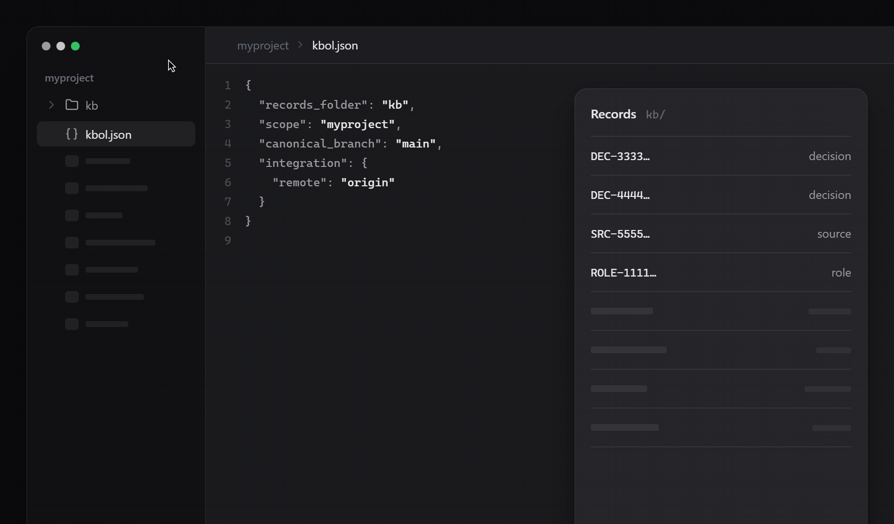

# KBOL · Knowledge Base Operating Layer

[](https://github.com/dpalazon-dev/KBOL/actions/workflows/check.yml)
[](https://github.com/dpalazon-dev/KBOL/releases)
[](LICENSE)
[](pyproject.toml)

**Project decisions you can check: which rule is in force on any date, who approved it, and which page or lines each citation comes from.**

KBOL is a command-line tool that works on Markdown records inside your git repository: decisions, questions, facts, hypotheses, plans and sources. Every record carries an event history. From it, KBOL rebuilds what is in force on any date, refuses to integrate a change without the approval your policy requires, and checks that every citation points to the exact place in its original document.


## Quick start

Build a throwaway project with one approved decision and ask KBOL what is in force (needs git, bash and Python 3):

```bash
uv tool install git+https://github.com/dpalazon-dev/KBOL
git clone https://github.com/dpalazon-dev/KBOL && cd KBOL
bash examples/quickstart.sh /tmp/kbol-demo
```

[`examples/quickstart.sh`](examples/quickstart.sh) creates a role and a person, bootstraps the root of trust, proposes a decision, approves it, integrates it through the gate and queries it:

```text
[APPROVED] «The database is PostgreSQL»
  In force in full on 23 Nov 2026.
  Says: The project database is PostgreSQL 16.
  Approved by Ana Pérez on 23 Nov 2026, in these words: «I approve PostgreSQL as the database» (declared approval, not authenticated).
```

## What it is for

- **Know what has actually been decided.** "Is it still true that our database is PostgreSQL?" `kbol query` answers whether it is in force today, since when, who approved it and in which words, and which decision replaced it if it no longer applies. A rule nobody replaced does not expire for being old, and two rules that clash without a resolution come out as a conflict, not as "the most recent one wins".
- **Change things under control.** Records only change through an integration gate (`kbol propose`): it checks their shape, that closed content is not rewritten and that someone with authority approves, and it leaves a receipt for every operation.
- **Cite without making things up.** A fact cites its source by page and region of a PDF or by lines of a text, against the SHA-256 fingerprint of the original. `kbol citations` tells you whether each citation still resolves.
- **Give an agent reliable context.** `kbol session` prepares, for a coding agent, the constraints in force for the current task, and the skill shipped with the package (`kbol export_skills`) teaches the agent to query before assuming.

## How it differs

| | ADR folder or wiki | Agent memory or RAG | KBOL |
|---|---|---|---|
| What is in force on a date | You read it by hand | The most similar or most recent chunk | Computed from the event history |
| Two clashing decisions | Whichever you read | The most recent one | A declared conflict until a person resolves it |
| Who approved it | A convention | Unknown | An approval bound to the digest of what was approved, with a receipt |
| Citations | Links | Unversioned chunks | Page, region or lines against the fingerprinted original |
| Who can change it | Any commit | Direct writes | An integration gate |

KBOL is not a semantic search engine, a graph database or a server: it is a CLI over git and Markdown. `kbol search` finds records by keywords when you do not know their ID, but `query` is what decides what is in force. Approvals today are declared: the literal words of the approver, not authenticated (see [the design choices](docs/design-choices.md#non-conforming-mechanisms)).

## Status and roadmap

Alpha, version 0.13: the engine and the integration gate work and are tested. From 0.13 (KB-DPP 1.0) everything is in English: the contract, the record format, the CLI commands and options, the messages, the code and the documentation. Records and installations written for 0.12 use the old Spanish names; [`docs/glossary-es-en.md`](docs/glossary-es-en.md) maps every old name to its new one, and [the breaking-change notes](docs/breaking-changes.md) say how to migrate. Next come `kbol init` to set up a project in one step, agent setup and router skills, a public benchmark and, later, a Rust engine. Details in [ROADMAP.md](ROADMAP.md).

## Installation

Requires Python 3.10 or later, git and [uv](https://docs.astral.sh/uv/).

```bash
uv tool install git+https://github.com/dpalazon-dev/KBOL
```

To pin a version, append its tag to the URL (`…/KBOL@vX.Y.Z`). The command is `kbol`; `kbol --version` prints the installed version. To work on the code, see [CONTRIBUTING.md](CONTRIBUTING.md).

## Getting started

[`docs/getting-started.md`](docs/getting-started.md) takes an empty repository to an approved, queryable decision in eight steps: a policy with one role and one person, the installation file, the root of trust, the first proposal, its approval and the query.

## Concepts



*Illustration of how a KBOL knowledge base works. KBOL itself is a command-line tool; this view is not a product UI.*

- **Record.** A Markdown file with a YAML header (`type`, `id`, `state`, relations and `events`) in the records folder. Decisions split their text into clauses (`<clause id="C1">`), which other decisions can amend or repeal one by one.
- **Installation.** A JSON file in the repository (`kbol.json` by default) that says where the records are, the scope, the canonical branch and how integration works. The policy (roles and people) is made of records like any other.
- **Root of trust.** The first role and the first person are activated once with `kbol bootstrap`; from then on, every change goes through integration.
- **Integration.** `kbol propose` takes files from the working tree to the canonical branch through its own clone, with the approval the policy requires, and leaves a receipt.
- **Cut-off.** Every query takes `--valid-at`, the instant you are asking about, and accepts `--known-until` to answer with what was known at that time. KBOL never reads the clock on its own.

KBOL implements the KB-DPP 1.0 contract ([core](docs/reference/KB-DPP-core.md) and [implementation](docs/reference/KB-DPP-implementation.md)). What the contract leaves open and how KBOL settles it is in [the design choices](docs/design-choices.md); breaking changes, in [the breaking-change notes](docs/breaking-changes.md).

That a function exists here does not prove an operational capability in a project: only its use in an installation, with integration and receipt, does.

## Usage

Reference for every command. From a clone, prefix them with `uv run`; with the tool installed, `kbol` is enough. `kbol --help` lists the options.

```bash
uv run kbol validate PATH.md [--mode proposal|canonical|exchange]
uv run kbol migrate DOCS_PATH --revision <sha> [--installation kbol.json]
uv run kbol digest PATH.md --effects effects.json
uv run kbol consolidate ROOT --folder kb --revision <sha> --ids DEC-… --valid-at <instant> [--known-until <instant>] [--legacy] [--installation kbol.json]
uv run kbol ready ROOT --folder kb --revision <sha> --valid-at <instant> [--known-until <instant>] [--legacy] [--installation kbol.json]
uv run kbol impact ROOT --folder kb --base <sha> [--revision <sha>]
uv run kbol query ROOT --folder kb[,docs/decisions] --ids ID[#anchor] … --valid-at <instant> [--known-until <instant>] [--plain [--with-ids]]
uv run kbol search ROOT --folder kb[,docs/decisions] --query "text" [--include proposals not_in_force] [--limit N] --valid-at <instant> [--known-until <instant>] [--plain [--with-ids]]
uv run kbol support ROOT --folder kb[,…] --valid-at <instant> [--known-until <instant>] [--ids ID …] [--before-valid-at <instant>] [--before-known-until <instant>]
uv run kbol vocabulary ROOT --folder kb[,…] --valid-at <instant> [--known-until <instant>]
uv run kbol approval_package ROOT --folder kb[,…] --operation-id <op> --base <sha> --proposal <sha> --valid-at <instant> [--known-until <instant>] [--text]
uv run kbol propose ROOT --installation kbol.json --operation-id <op> --files PATH… [--effects effects.json] [--imports imports.json] [--approvals approvals.json] [--actor <actor>] [--until dry_run|integrate|push] [--valid-at <instant>] [--text]
uv run kbol integrate ROOT --canonical-branch main --folder kb[,…] --operation-id <op> --base <sha> --proposal <sha> --approvals approvals.json --receipts <dir> [--remote origin] [--approval decisive --actor <actor>]
uv run kbol drift ROOT --folder kb[,…] [--canonical-branch main] [--staged]
uv run kbol citations ROOT --folder kb[,…] [--store DIR]
uv run kbol integrity ROOT --folder kb[,…] [--store DIR]
uv run kbol links ROOT [--folder docs[,…]] [--installation kbol.json]
uv run kbol bootstrap ROOT --canonical-branch main --folder kb[,…] --operation-id <op> --base <sha> --person <PER> --roles <ROLE>[,…] --declaration declaration.json --receipts <dir>
uv run kbol handoff ROOT --task <id> [--save handoff.json] [--canonical-branch main]
uv run kbol context ROOT --task <id> --scope <scope> --folder kb --installation kbol.json --valid-at <instant> [--goal …] [--budget N] [--legacy-folder docs] [--text]
uv run kbol verify ROOT --task <id> --installation kbol.json --check <id> [--canonical-branch main]
uv run kbol session FOLDER --event start|stop|commit --installation kbol.json [--task <id>] [--valid-at <instant>] [--origin compact] [--paths PATH …] [--text]
uv run kbol export_skills DEST [--skills NAME …]
```

Queries never read the environment clock: `--valid-at` is mandatory. Without `--revision` they read the working tree and say so; without `--known-until` they use the whole admitted history and say so. They only load canonical records of the profile, and an invalid record is reported in the coverage. The legacy format is skipped unless `--legacy` is given (`query`, `support` and `vocabulary` always read it): it is then read separately, named in the result and never in force ([choices](docs/design-choices.md#compatible-reading-during-the-transition)). It is the default legacy format unless the installation declares its own in `legacy_format` and is passed with `--installation` ([choices](docs/design-choices.md#legacy-format-of-another-project)).

`session` is the command for an installation's hooks ([choices](docs/design-choices.md#commands-for-an-installations-hooks)) and the only one that reads the clock: on `start`, without `--valid-at`, it uses the current instant and declares it in the envelope. With `--text` it outputs only what the hook injects into the session.

Every output is the contract envelope (`operation`, `operation_id`, `revision`, `valid_at`, `known_until`, `result`, `warnings`, `coverage`). Exit codes: 0 completed, 1 failed, 2 blocked, 3 partial.

## Modules

The "Control" column points to the KB-DPP contract controls each module implements.

| Module | Responsibility | Control |
|---|---|---|
| `model` | Closed vocabulary of the contract: record types, ID prefixes, legacy ID forms and enumerations | — |
| `timeutil` | ISO 8601 instants with time zone and day dates, without reading the environment clock | — |
| `verification` | Common error of approval verifiers, whatever their channel, and canonical form of a review to recognise it when repeated | VAL-04 (form) |
| `core` | Safe header parsing (no duplicate keys, tags, aliases or merges; dates as text) and validated writing with round trip | VAL-01 |
| `schema` | Common and per-type fields, relations allowed by origin, nested objects, events by class, body marks; in canonical mode, state against history | VAL-01 |
| `markdown` | Grammar of `<clause>` and `<fact>`, ignoring code and escapes | VAL-01, VAL-06 (form) |
| `events` | State rebuilt from admitted events and validity in a half-open interval | VAL-05 |
| `projection` | Total projection of `status` for a revision and two explicit cut-offs | VAL-08 |
| `references` | Resolvable references, target type, anchors and forbidden cycles over a snapshot | VAL-02, VAL-07 |
| `digest` | Approvable object and contract digest, with published vectors in `kbol/vectors/digest.json` | VAL-04 (digest) |
| `consolidate` | Clauses in force at two cut-offs, for a whole decision or one clause (`ID#anchor`), with origin, chain and declared authority; proposals, future ones and conflicts apart; never revives texts | VAL-05, VAL-06 |
| `dependencies` | `depends_on` conditions and ready milestones; cancelling is not fulfilling | VAL-07 |
| `mutability` | Proposal against the base: records, states, events, closed content, fingerprints and policy changes | VAL-03 |
| `snapshot` | Loading canonical records from disk or from a git revision | VAL-14 (coverage) |
| `authority` | Valid approvals under the base policy: computed digest, verified identity, active human person, role held in its scope and role rule | VAL-04 |
| `github` | Verifier of pull request reviews against the GitHub API; disabled without `KB_GITHUB_TOKEN` | VAL-04 |
| `declared` | Verifier of declared approvals: the person's quote in a conversation, bound to the digests shown to them; never authenticated (choices, "Non-conforming mechanisms") | VAL-04 (partial) |
| `bootstrap` | Root of trust of an installation, once: activates the role that governs the policy and the founding person, with the account verified on GitHub (`GET /user`) or, as a non-conforming mechanism, with their declared and quoted identity; afterwards every change goes through integration | VAL-04 (root) |
| `integrate` | Integration into a canonical branch without checkout: expected base, mutability, authority, admitted events, conflicts, domain vocabulary in the final tree, compare-and-swap commit, idempotent receipt and reconciliation. With `approval="decisive"`, only decisive changes need approval and every event carries the operation's actor | VAL-13, VAL-15 (partial) |
| `package` | Approval package (`kbol approval_package`), read-only: per touched record, what changes in the header and in each clause, the requested effects, whether it is decisive and why, its supports and whether they are in force, and its digest; the impact, what it does not evaluate and the skeleton of the declared approval. It uses the same code as the gate and, if the gate would block, blocks first with the same code | — |
| `propose` | Integration operator (`kbol propose`): takes files from the working tree to the canonical branch through the integrator's clone (`$KBOL_STATE/<repository>/integrator.git`). Dry run by default; `--until integrate` writes the clone's canonical branch and `--until push` also runs `git push` without forcing. It does not build approvals: it receives the declared ones and, if one is missing, the dry run returns the approval package and exits with 3. After integrating it runs the steps the installation declares and commits the views they regenerate | VAL-13 (operation) |
| `importing` | Guard for importing a legacy record: same body except marks and whitespace, regenerated provenance and no new text | VAL-02, VAL-03 |
| `fingerprints` | Fingerprint of every record written by integration and the root of trust, and `drift`: records with history edited outside the flow; warns, does not block. With the canonical branch, also the commits that change records without going through the gate | — (local choice) |
| `export` | KBOL skills packaged in `kbol/skills/` and `kbol export_skills`, which writes them with the installed version in their header; only overwrites what it exported itself | — ([choices](docs/design-choices.md#packaged-skills)) |
| `impact` | Consumers affected by a change, with cause, path and owner | VAL-09 |
| `handoff` | Task state separate from the conversation (goal, authorisation, limits, checks, blockers and next step), stored locally in `.kbol/handoffs/`, with git facts; declares what is missing and runs nothing | ESC-05 |
| `verify` | Runner of the checks declared in the installation (id, command as an argument list, timeout and expected code), without a shell or caller arguments. Records the result in the task handoff with the tested revision and tree | `verify` operation (partial) |
| `context` | `context`: a task's package with the decisive constraints, which are never trimmed; proposals and pending items apart as non-binding; procedures, handoff, omissions and refresh conditions | ESC-06, ESC-09 (partial) |
| `session` | Commands for an installation's hooks (`kbol session`): `start` gives the task's context package and the drift with a single load and reuses it from `.kbol/session/` while nothing that decides it changes; `stop` validates as proposals the records with uncommitted changes; `commit` warns about drift in the git index without blocking | — |
| `query` | Query by `ID` or `ID#anchor`: the record with its state at the cut-off, its authority (who approved, when, through which channel and with which words, as the record keeps them; never checked), its relations and the anchor text; for a decision, whether that clause is in force; for its supports, whether they exist and are in force; work fields and, for a person, what is assigned to them | RES-01, RES-04 (partial) |
| `search` | In-memory lexical search (`kbol search`): candidates by text or alias with ID, anchor, state, validity and snippet; by default only what is in force, with proposals and what is no longer in force counted and shown only on request. It does not decide what is in force | Core §8 (exploration) |
| `supersessions` | Lexical hint `UNDECLARED_SUPERSESSION`: a record that says it replaces or repeals another without declaring it in `amends` or `supersedes`. Flags, does not block | — |
| `plain` | Plain-language output of `query`, `consolidate` and `search` (`--plain`, IDs with `--with-ids`) | — |
| `support` | Read-only query (`kbol support`): for each record, whether its supports (`based_on`, `dependencies`, `sources` and `<fact ref>`) are in force at both cut-offs, with the source field, the situation and its reason, and a summary; with a second pair of cut-offs, the supports whose situation changes and the chain that explains it. Flags, does not block | — |
| `vocabulary` | Domain vocabulary (`kbol vocabulary`): the entity classes declared by decisions with `defines` and in force at both cut-offs, their aliases, undetermined and retired terms, and the scopes of active roles; flags undeclared and retired terms with their uses. Flags, does not block; the integration gate blocks activating an entity whose class is not in force | — |
| `migration` | Read adapter for the legacy format, the default one or the one the installation declares: dry inspection, no writing | — |
| `locator` | Shape of `sources[].anchor` locators: `lines-v1` (lines), `pdf-v1` (physical page and normalised region) and `norma-v1` (logical unit of a regulation), combinable as `norma-v1:… @ pdf-v1:…` | RES-04 (form) |
| `citations` | Citation resolver (`kbol citations`): fingerprint of the original and the representation, page, region, logical unit and normalised literal quote against an `estructura-v1` structure; text by lines against the blob of the anchored revision; a document without pages (Word, spreadsheet, HTML) by lines of its text representation. It does not read PDFs or import processors | RES-04 (partial) |
| `integrity` | Source integrity (`kbol integrity`): compares each source's `sha256` with the bytes at its `location`, without normalising them, in the store, in an anchored revision or in the working tree. What could not be looked at is not reported as broken | VAL-10 (partial) |
| `links` | Links in a repository's Markdown documents (`kbol links`): internal paths with their case, fragments against the target's anchors, repeated explicit anchors and absolute local paths, with markdown-it and ignoring code. A broken link exits as failed | — ([choices](docs/design-choices.md#documentation-links)) |
| `cli` | `kbol` entry point: dispatches the enabled operations, always returns the contract envelope and fails closed on the disabled ones; sets the exit codes | — |

## Limitations

`ingest` returns `blocked` in the CLI. `integrity` checks every time and does not store the last valid check, and `available_with_integrity` dependencies still do not use it. `verify` only runs declared checks and does not isolate them: it limits nothing beyond time, emits no receipts, and on Windows it does not stop a process the command leaves running after finishing. `impact` is a read-only query between two revisions. `bootstrap` and `integrate` are exposed in the CLI only with the declared mechanism (choices, "Non-conforming mechanisms"). `propose` is the only command that pushes, only with `--until push` and never forcing; if the remote rejects the push or a later step fails, what was integrated stays in the integrator's clone and the command does not undo it. It does not check that the working tree starts from the head of the canonical branch. Approval through GitHub pull request reviews exists as a library and is not exposed in the CLI, and the GitHub verifier has not been tested against the real service. Backup restore, check isolation and ingestion are missing. Search without an ID (`search`) is lexical, with no semantic similarity or persistent index. There are no delegations between roles and no MCP server: the policy is limited to roles and people. Converting 0.12 records and installations to the 0.13 names with `kbol migrate` is planned and not available yet: today `migrate` only inspects the legacy format, without writing.

## Tests

`tests/`, on Python 3.10 and 3.14, and those of `tools/di` (document processing with Docling) in their own project. `uv run python tools/check.py` runs everything together with static analysis; `--no-di` skips `tools/di`, and `--quick` also runs the suite only once. `uv run python tools/check.py --install-hook` installs the quick pass as a `pre-push` hook. `tests/legacy/` holds invented records in the legacy format to test the migration adapter, with their fingerprints in `tests/legacy/README.txt`.

## License

Apache-2.0: [LICENSE](LICENSE) and [NOTICE](NOTICE). Copyright 2026 David Palazón.
